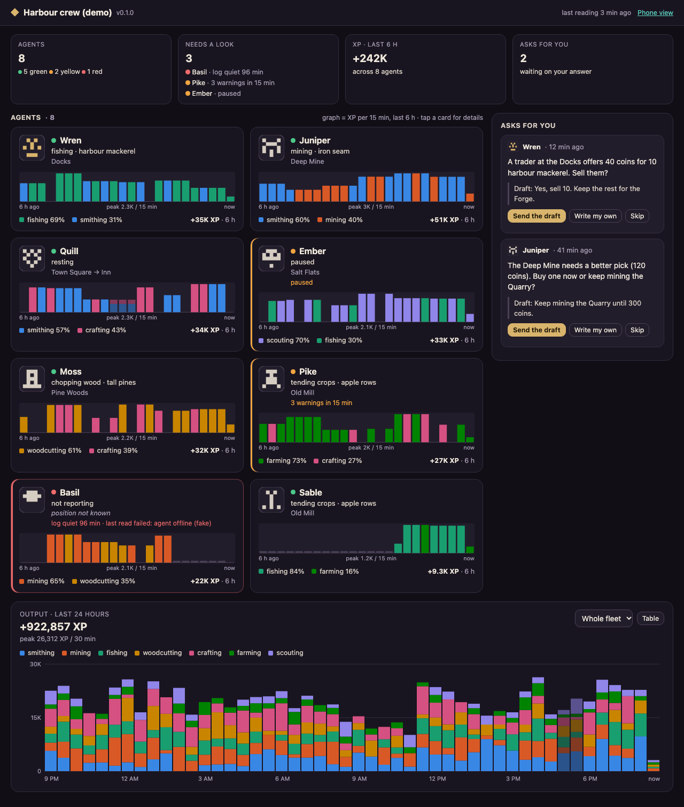
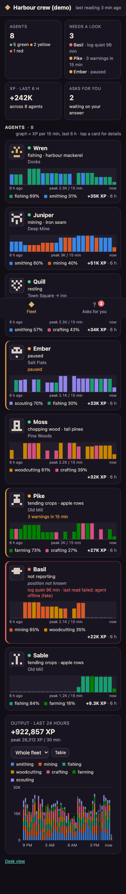
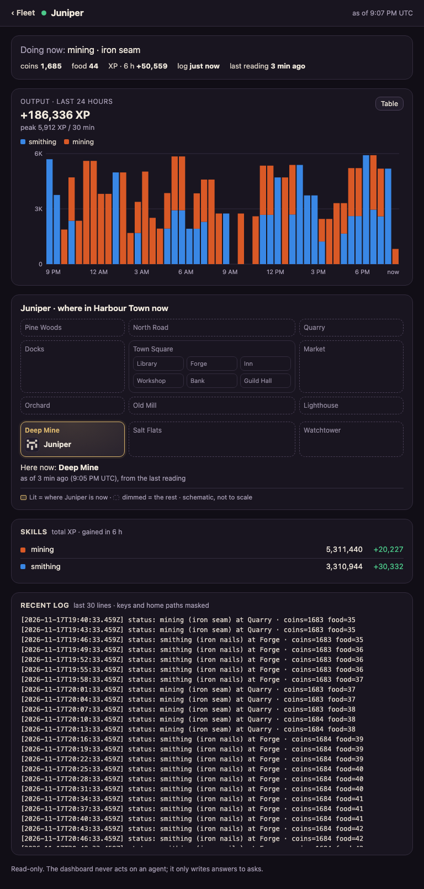

# fleet-dashboard skill

Teaches an AI agent to set up one private page for every agent someone runs. Each agent gets a card with a status light and the reason for it, its job and one number for it, what it's doing, where it is, the last thing it did, and a 6-hour graph by skill. Retired agents drop into one grey strip. Each agent's Details page has a map, a 24-hour graph, its skills and a masked log. There's an "Asks for you" inbox and a phone layout. One Node process, zero dependencies, 127.0.0.1 only, read-only toward agents. Adapters plug agents in: Midnight City, any status command, any status file, or your own.

```sh
node scripts/deck.mjs --demo        # a made-up fleet, nothing to set up → http://localhost:7700
```

| Demo, desk | Demo, phone | Demo, Details |
|---|---|---|
|  |  |  |

All screenshots are of the demo: invented agents in an invented town.

| File | For |
|---|---|
| `SKILL.md` | The agent: when to use it, the steps, the safety rules, what to report |
| `scripts/deck.mjs` | The dashboard: `--demo`, `--config`, `--check`, `--once`, `--no-sampler`, `--port` |
| `scripts/install.mjs` | Always on: writes and starts a launchd agent (macOS) or a systemd user service (Linux) |
| `scripts/fleet.example.json` | A config to copy: one Midnight City agent, one status command, one status file (retired), with jobs and "Last:" rules |
| `scripts/adapters/` | `midnight-city`, `command`, `file`, `fake`, and the contract (`index.mjs`) |
| `scripts/lib/` | Config, sampler, history maths, lights, jobs and "Last:", logs, masking, asks, the web server, the demo |
| `scripts/public/` | The pages: cards, map, graphs, asks, phone layout. No build step, strict CSP |
| `scripts/selftest.mjs` | 175 checks, no network, no browser (about 5 seconds) |
| `references/config.md` | Every config field, and exactly when a light turns yellow or red |
| `references/adapters.md` | The Sample and Map shapes, the built-in adapters, writing your own |
| `references/midnight-city.md` | What the City adapter reads (one read-only call), its map, use with city-driver-starter |
| `references/asks.md` | The asks inbox, file by file |
| `references/always-on.md` | launchd, systemd, updating, phone access through a private proxy |
| `references/api.md` | The JSON routes and the history file format |

**Needs:** Node 20+. For Midnight City agents, the City's [direct-control skill](https://midnight.city/docs/connect-to-midnight-city/hermes-openclaw/).

**Status:** in development. See the table in the [halfhand-skills README](https://github.com/Beo-Halfhand/halfhand-skills#skills).
