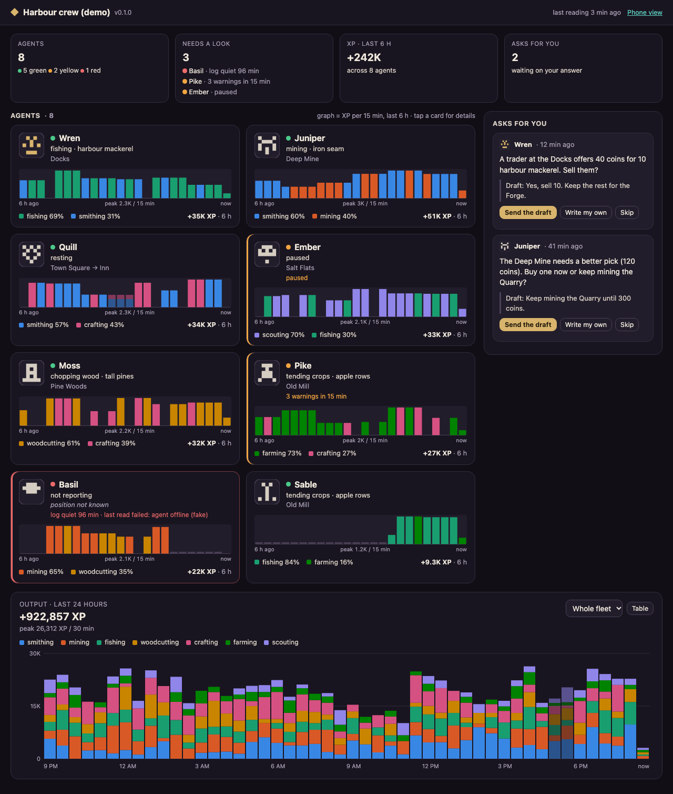

# fleet-dashboard

**What it is.** One page for every agent you run. [`scripts/deck.mjs`](scripts/deck.mjs) is a small web server plus a sampler, in one Node process with no dependencies:

- **The sampler** reads each agent once every few minutes through its **adapter** and appends one line to a history file. It is the only part that talks to agents.
- **The page** is built from files only: that history, each agent's log, its PAUSE file, and the asks folder. Opening it ten times costs your agents nothing.

What you see:

| Where | What |
|---|---|
| **Main page** `/` | A glance band (how many agents are green, yellow or red; who needs a look and why; XP in 6 h; open asks). **One card per agent**: a generated sigil, name, status light, **its job** (with its slot, and its status when it isn't live), what it's doing now, where it is, a 6-hour graph (one bar per 15 min, stacked by skill), its top two skills and its 6 h total, then **the job's one number** and **"Last:" the last meaningful thing it did**, with how long ago. The main agent comes first, then the rest by 6 h output. Retired agents get no card, only a name in a grey **Retired** strip under the cards. Below that, the whole fleet's last 24 hours. |
| **Details** `/agent?key=…` | The light and the reason for it, counters, the agent's 24-hour graph, **its own map** (every place named, only its place lit), its skills, and the last 30 log lines with keys and home paths masked |
| **Asks for you** | Questions your agents left for you, with their draft answer. You send the draft, write your own, or skip. Each choice asks you to confirm first |
| **Phone** `/m` | The same cards and asks in one column with two tabs. You can add it to your home screen |



**The light.** Red: the log has been quiet longer than `staleMinutes`, the log is missing, or readings stopped (for agents with no log). Yellow: paused (a PAUSE file exists and its `until`, if it has one, hasn't passed), the last read failed (the reason is shown), 3 or more warning lines in 15 minutes, or no reading yet. Otherwise green. The card says why in plain words.

**Not covered:** controlling agents. There is no pause button, no chat, no "send". The dashboard only **writes** answer files for asks. Also not covered: alerts and paging (pair it with a scheduled check if you need one), and agents spread over many machines (one dashboard reads files on one machine).

## When to use

- Someone runs more than one agent (bots, game agents, coding agents, scrapers) and wants to see them all on one page instead of tailing logs.
- They want to know at a glance which agent is stuck, silent or failing, and why.
- They play Midnight City with self-hosted agents and want XP graphs and a map of where each agent is.
- They want to check on their agents from a phone without opening anything to the internet.

## Steps

### 1. Try it (no setup)

```sh
node --version                                   # 20 or newer
node <this skill>/scripts/deck.mjs --demo        # then open http://localhost:7700
```

`<this skill>` is the folder that holds this SKILL.md. No browser (a server, an agent)? `curl -s http://localhost:7700/api/fleet` returns what the page draws: each agent's `light`, `why`, `doing` and `place` ([references/api.md](references/api.md)).

The demo builds a made-up crew of 8 agents in an invented harbour town, in a temporary folder, with 26 hours of history. Everything in it is invented. It shows all three lights: one agent paused, one with warnings, one gone silent. Every agent has a job, a number and a "Last:" line, and a ninth agent is retired, so it shows only in the Retired strip. It also has two open asks and one agent whose history starts late. Ctrl-C ends it and removes the folder. `--port 7800` picks another port.

Run the self-test once on the machine it will live on:

```sh
node <this skill>/scripts/selftest.mjs           # expect: selftest: 175 ok, 0 failed on macOS (about 5 seconds)
                                                 # Linux: 174, or 175 when systemd-analyze is installed
```

### 2. Copy it out and write the config

```sh
mkdir -p ~/fleet-dashboard && cp -R <this skill>/scripts/. ~/fleet-dashboard/ && cd ~/fleet-dashboard
cp fleet.example.json fleet.json
```

One entry per agent. Every field is in [references/config.md](references/config.md). The parts that matter:

| Field | What it does |
|---|---|
| `key` | Short id in URLs and files: lowercase letters, digits, `-`, `_`. Changing it starts a new history |
| `name` | What the page shows |
| `main` | `true` for at most one agent: it goes first and its sigil is brass |
| `adapter` | How to read this agent: `midnight-city`, `command`, `file` (or `fake`, demo only) |
| `log` | The agent's log file (optional but recommended). Its age drives the red light; the last 30 lines show on Details |
| `pauseFile` | If this file exists, the agent counts as paused (yellow, not red, when quiet), until the `until` time inside it passes. An expired PAUSE is ignored |
| `staleMinutes` | How long the log may stay quiet before the light goes red (default 30). Set it above the longest quiet stretch the agent normally has |
| `warnPattern` | A regular expression for warning lines; 3 in 15 minutes turns the light yellow |
| `logCounters` | Numbers to pull from the log, e.g. `{ "coins": "coins=(\\d+)" }`: the last match is shown |
| `job` | The job in words and one number for it: `{ "title": "Woodcutting at the tree stand", "slot": "night shift", "number": { "label": "Woodcutting total", "xp": "woodcutting" } }`. The number comes from an XP total (`xp`), a counter (`counter`, `"as": "rank"` shows `#12`) or text you keep up to date (`value`, with `asOf`). A missing reading shows "—, not read yet", never 0 |
| `lastDid` | What "Last:" reads in the log: a list of rules, like `[{ "match": "DONE (\\w+) block", "say": "$1 block done" }]`. The newest matching line wins, and only the `(groups)` are copied into `say`, masked. **Never capture chat text or anything personal** |
| `retired` / `retiredFile` | `true` (or a short note), or a file whose existence retires the agent with no restart. A retired agent is never read, never red and never counted; its name sits in the Retired strip. Delete the file to bring it back |

### 3. Plug in your agents

Pick the adapter that fits. Details and the exact JSON in [references/adapters.md](references/adapters.md).

- **Midnight City** (`"adapter": "midnight-city"`): give it the City skill folder and the agent id. Every round it makes **one read-only call**, `progression <agentId>`, through the City's own helper, from that folder. It reads XP per skill, what the agent is doing, and which space it is in. It never connects, never acts, and never reads your `.env`. The map is the City's districts with Central's buildings inside. If you run [city-driver-starter](../city-driver-starter/), point `log` and `pauseFile` at its folder. See [references/midnight-city.md](references/midnight-city.md).
- **Any agent with a status command** (`"command"`): the dashboard runs your program (a list, no shell) and reads one JSON object from its output: `{ "xp": {…}, "doing": {…}, "position": {…}, "counters": {…} }`. Every field is optional.
- **Any agent that can write a file** (`"file"`): the agent keeps a small `status.json` up to date. A file older than `maxAgeMinutes` counts as a failed read.
- **Something else** (another game, a framework with an API): write an adapter. It is one small module with `check`, `sample` and, if you like, `map`. The contract is in [references/adapters.md](references/adapters.md).

Then check it. This reads each agent once and writes nothing:

```sh
node deck.mjs --config fleet.json --check
#   ✓ scout (midnight-city): 6 skill(s), doing "gather resource", at Forest, log found
```

Fix every ✗ and `!` before going on. The reasons are the adapter's own words, masked. A `!` under an agent means its job's number names a skill or counter this reading doesn't have (a typo shows "—, not read yet" forever). A retired agent shows as `– key: retired, not read`, and a `jobsFile` gets its own line with any problems in it.

**Jobs that change often:** put them in a separate file and set `"jobsFile": "./jobs.json"` at the top level: `{ "agents": { "<key>": { "title": "…", "number": {…} } } }`. The dashboard re-reads it at most once a minute, so a new job shows up without a restart. An entry there wins over that agent's `job` in fleet.json, and a broken file falls back to fleet.json. Details in [references/config.md](references/config.md#job-number-last).

### 4. Run it

```sh
node deck.mjs --config fleet.json                # http://localhost:7700  ·  phone layout: /m
```

It worked if `curl -s http://localhost:7700/api/health` says `"ok":true` (no curl, as in slim containers: `node -e "fetch('http://localhost:7700/api/health').then(r=>r.text()).then(console.log)"`). The sampler reads every `sampleMinutes` (default 5), so a new agent with no `log` shows yellow "no reading yet" until then (one with a fresh log is green): `node deck.mjs --config fleet.json --once` takes a reading now. The first graphs need two readings (one interval). History is kept `keepDays` (default 7) in `dataDir/history/`, one file per day.

Stop it with Ctrl-C, or `kill <pid>` if it runs in the background.

### 5. Keep it running (always on)

[`scripts/install.mjs`](scripts/install.mjs) writes the service file for you. It checks the config first, never runs as root, and starts nothing unless you say `--start`. With no `--write` or `--start` it only prints the file:

```sh
# macOS (launchd: starts at login, restarts if it stops)
node install.mjs --launchd --config ~/fleet-dashboard/fleet.json            # look at it
node install.mjs --launchd --config ~/fleet-dashboard/fleet.json --start    # write local.fleet-dashboard.plist to your LaunchAgents folder and start it

# Linux (systemd user service)
node install.mjs --systemd --config ~/fleet-dashboard/fleet.json --start    # ~/.config/systemd/user/fleet-dashboard.service
loginctl enable-linger                                                      # keep it running while you're logged out

# stop and remove (prints the commands; your data stays)
node install.mjs --launchd --uninstall      # or --systemd --uninstall
```

**No systemd** (a container, WSL, a minimal VM): `--start` says so and writes nothing. Run it in the background instead, with a `@reboot` cron line to bring it back: [references/always-on.md](references/always-on.md#no-service-manager). The systemd unit is checked with `systemd-analyze verify`; it hasn't yet been run as a live service.

The service runs the copy in `~/fleet-dashboard`, not the one inside this skill, so updating the skill doesn't change a running dashboard. After you edit `fleet.json`, restart the service. Details and logs: [references/always-on.md](references/always-on.md).

### 6. Optional: your phone

The dashboard only listens on 127.0.0.1, and it should stay that way. To reach it from a phone, use a **private** network you already trust (a mesh VPN you sign in to) and put its proxy in front: one that serves a local port only to your own devices and adds a header naming the signed-in user. **Never** use a public tunnel. Then tell the dashboard which host and which logins to accept:

```json
"access": { "hosts": ["<the host name your phone uses>"], "loginHeader": "<the header your proxy sets>", "allowLogins": ["you@example.com"] }
```

Any other Host gets 421, and a login that isn't listed gets 403. See [references/always-on.md](references/always-on.md#phone).

### 7. Optional: asks

Set `"asksDir"` (relative to `fleet.json`, or absolute). The dashboard creates it (mode 700) when it starts; give your agents its **absolute** path, and run them as the same user as the dashboard. An agent that wants your decision writes `<asksDir>/<id>.json`. The dashboard shows it under "Asks for you". Your answer becomes `<asksDir>/answers/<id>.json`, written once and never changed. The agent reads the answer and **applies its own rules** before acting on it. The file format and an example agent loop are in [references/asks.md](references/asks.md).

## Safety rules

- **Read-only toward agents.** Adapters read; the dashboard has no route that acts on an agent. The one thing it writes outside its own data folder is an answer file, and only after you confirm on the page.
- **Localhost only.** It binds 127.0.0.1 and checks the Host header, which also blocks DNS-rebinding tricks. Reach it from elsewhere only through a private proxy with a login allow list (step 6). Never put it on the public internet: it shows your agents' logs and places.
- **Keys stay where they are.** The Midnight City adapter runs the City's helper from its own folder with only `PATH` and `HOME`. The helper reads its own `.env`; the dashboard never does. The command adapter passes only `PATH`, `HOME` and the variable **names** you list. Never put a key in `fleet.json`.
- **Everything shown is masked**: log lines and read errors go through a masker (key=value secrets, bearer tokens, common key shapes, JWTs, long tokens, seed-phrase-like word runs, home folder names). It is a net, not a guarantee. Keep secrets out of logs in the first place.
- **The page can't run anything it didn't ship with**: a strict Content-Security-Policy (no inline script, no outside requests), text inserted as text only, `no-store` caching, and POSTs need a custom header and the same origin.
- **One controller per agent still applies.** The dashboard doesn't control agents, so it never fights your driver. Don't add a control button by letting a model choose actions.
- **Screenshots:** before you share one, check that it shows no ids, places or names you mind being public. For posts, use the demo.

## Report back

When you set this up for someone, tell them:

- the demo ran (or the self-test line);
- each agent's adapter and the `--check` line (✓ or ✗ and why);
- the URL, the port, and where history and the dashboard's own log (`dataDir/deck.log`) live;
- whether it's always-on (launchd or systemd, and the label), and how to stop it;
- whether phone access is on, through what, and which logins are allowed;
- any agent whose light isn't green after the first 10 minutes, with the reason the card gives.

## More

- [references/config.md](references/config.md): every config field
- [references/adapters.md](references/adapters.md): the adapter contract, the Sample and Map shapes, the built-in adapters, writing your own
- [references/midnight-city.md](references/midnight-city.md): what the Midnight City adapter reads, its map, using it with city-driver-starter
- [references/asks.md](references/asks.md): the asks inbox, file by file, with an example
- [references/always-on.md](references/always-on.md): launchd, systemd, logs, updating, phone access
- [references/api.md](references/api.md): the JSON routes and the history file format, for building on top

## Status

**In development.** Rewritten from a private dashboard in daily use with Midnight City agents, with the game moved behind an adapter and every setup detail taken out. Tested on Node 26, macOS arm64: `selftest.mjs` 175/175 (config, masking, history maths, logs, asks, all four adapters, lights, jobs, "Last:", retired agents, the server's guards, the command line, the service files); [fit-check](https://github.com/Beo-Halfhand/fit-check) at all nine widths on the demo's main and phone pages (clean) and Details (two map labels a few pixels too wide at 320 and 1024 px, known); and the Midnight City adapter's `--check` against one live agent (read-only). Also run by a fresh agent following only this file on Node 22, Debian 12 (a container, no systemd, no browser): demo, self-test, two agents (`command` and `file`), `--check`, the JSON routes and an ask round trip; run again for 0.2.0 (jobs, "Last:", a jobs file and retired agents: all worked; its fixes are in). Version 0.2.0 brings the cards in line with the private dashboard it came from (its v0.15.3, 18 November 2026). The systemd unit passes `systemd-analyze verify` (systemd 252); it hasn't been run as a live service. The City is a preview game: its helper's fields can change, so re-run `--check` when its skill updates.
